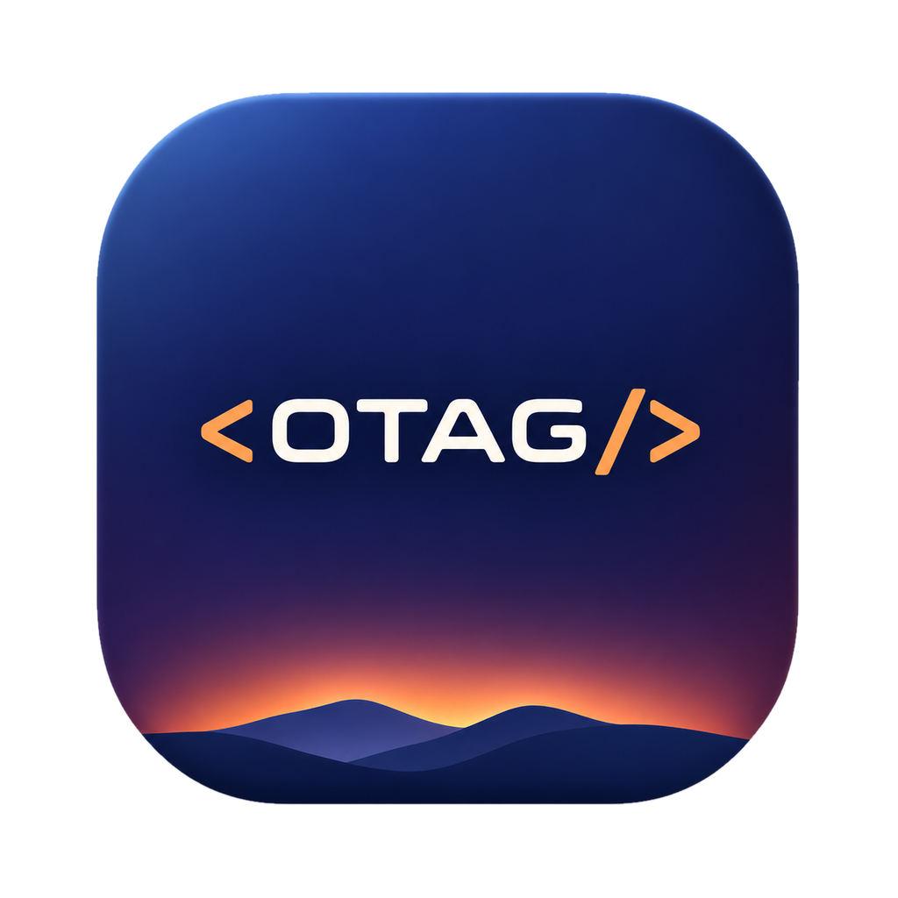

<p align="center">
  
</p>

<h1 align="center">otag</h1>
<p align="center"><strong>A local workspace for Claude Code and Codex CLI.</strong></p>
<p align="center">Run agents side by side, see which one needs your attention, and hand off work with its context.</p>

<p align="center">
  <a href="#quick-start">Quick start</a> ·
  <a href="#under-the-hood">Under the hood</a> ·
  <a href="CONTRIBUTING.md">Contributing</a>
</p>

## What you can do

- **Run agents side by side.** Organize sessions by project in the terminal or the native macOS app.
- **See what needs your attention.** Check which agent is working, finished, or waiting for approval. The macOS app lets you respond from the session list.
- **Track usage and hand off work.** See reported usage limits and reset times, or pass a task from Claude Code to Codex CLI with a local handoff file.
- **Pick up where you left off.** Sessions keep running when you close the client. After a restart, otag restores the layout and resumes agent sessions it can identify.

## Quick start

otag is **pre-alpha** and continues to evolve based on what comes up in day-to-day use.

To build from source and try agent tracking, install Git, a stable Rust toolchain (1.88 or newer), and at least one of the supported agent CLIs.

```sh
git clone https://github.com/yasarslan/otag.git
cd otag
```

### macOS app

Requires macOS 14 or newer and a Swift 6 toolchain (Xcode 16 or newer).

```sh
./scripts/bundle-app.sh
open target/Otag.app
```

Choose a project folder and start a Claude Code or Codex session. Use **Arrange** to see multiple sessions together, **Limits** to check reported usage, or **Switch agent** to hand off a task.

### Terminal client

On macOS or Linux, run this from the repository:

```sh
cargo install --locked --path crates/otag
otag
```

In an otag pane, run `claude` or `codex`. Press `Ctrl-b`, then `%` to split the pane, or `Ctrl-b`, then `d` to detach. Run `otag` again to reconnect. From a separate shell, run `otag ls` to list sessions or `otag usage` to see reported limits.

For Claude Code usage reporting, run `otag install-hooks` and review the proposed settings changes. The macOS app also offers this setup on first launch.

## Under the hood

A Rust daemon owns the terminal processes and persists session state in SQLite. The Ratatui terminal client and SwiftUI macOS app talk to it over a local Unix socket. otag reads local agent events and session logs for status and usage.

| Start here | What you’ll find |
| --- | --- |
| [`crates/otag-core/`](crates/otag-core/) | Terminal processes, panes, workspaces, and the socket protocol |
| [`crates/otag-agents/`](crates/otag-agents/) | Claude Code and Codex CLI integrations |
| [`app/`](app/) | SwiftUI app and its daemon client |

[Architecture notes](ARCHITECTURE.md) · [Build and test guide](CONTRIBUTING.md) · [MIT license](LICENSE)
